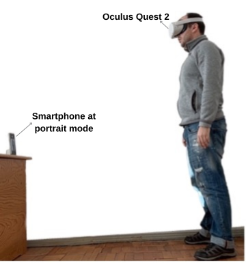
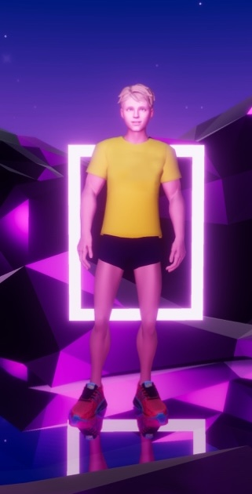
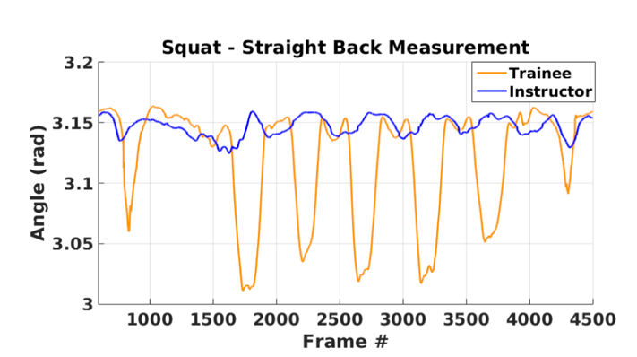
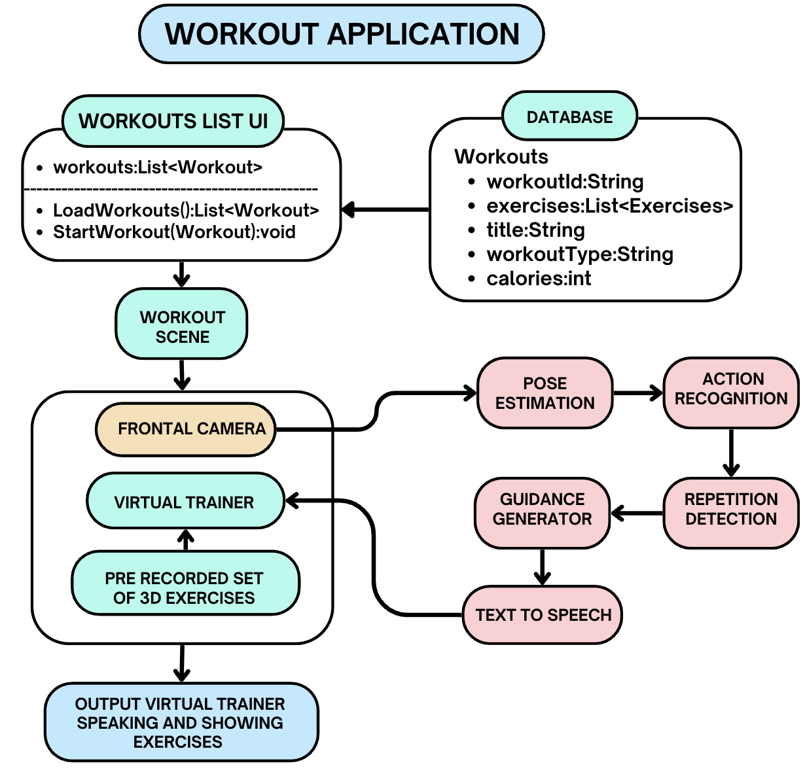
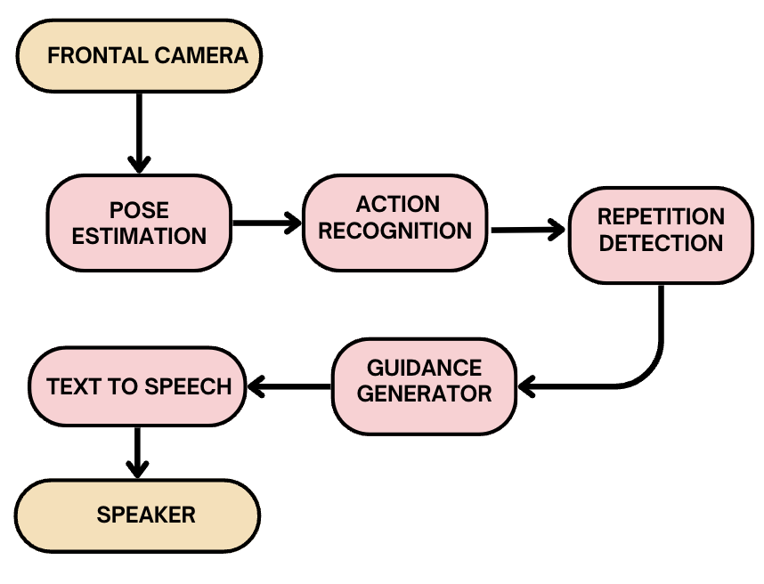

# VR Rehab Motion Assessment

Unity C# research code for a virtual-reality rehabilitation application. The code supports pose-based exercise assessment, repetition counting, interactive workout activities, avatar control, and communication with a Flutter host application.

This repository contains Unity application scripts from the research system described in an IEEE EDUCON 2024 conference paper and in an extended journal manuscript (VIRTA). It is a partial, code-only extract rather than a complete, directly runnable Unity project; see [Scope of this extract](#scope-of-this-extract).

## Main capabilities

- Pose landmark processing and pose similarity analysis
- Exercise repetition detection and counting
- A Dynamic Time Warping (DTW) nearest-template matching demonstration
- Interactive and performance workout modes
- Workout JSON loading and state management
- Unity-to-Flutter messaging
- Avatar, scene, camera, audio, and AssetBundle utilities

## Research figures

<table>
  <tr>
    <td width="50%" align="center" valign="top">
      
      <br>
      <sub><strong>Capture setup</strong><br>VR headset and smartphone placement for full-body exercise capture.</sub>
    </td>
    <td width="50%" align="center" valign="top">
      
      <br>
      <sub><strong>Immersive trainer</strong><br>Virtual personal trainer in the workout environment.</sub>
    </td>
  </tr>
  <tr>
    <td colspan="2" align="center" valign="top">
      
      <br>
      <sub><strong>Movement assessment</strong><br>Straight-back angle comparison between the trainee and instructor during squat repetitions.</sub>
    </td>
  </tr>
</table>

The figures above are reproduced from the accompanying [IEEE EDUCON 2024 paper](https://ieeexplore.ieee.org/document/10578849).

## System overview

<table>
  <tr>
    <td width="58%" align="center" valign="top">
      
      <br>
      <sub><strong>System architecture</strong><br>The presentation path plays the recorded instructor motion on the virtual trainer; the measurement path turns the camera stream into spoken guidance.</sub>
    </td>
    <td width="42%" align="center" valign="top">
      
      <br>
      <sub><strong>Measurement chain</strong><br>Camera, pose estimation, action recognition, repetition detection, guidance generation and speech output.</sub>
    </td>
  </tr>
</table>

These two figures are from the VIRTA journal manuscript (under review).

## Repository structure

```text
.
├── Avatar/                 # Avatar selection, naming, and idle animation
├── Character/              # CharacterControllerBase, shared by every workout mode
├── Loader/                 # Scene loading, AssetBundles, backend API, Flutter bridge
├── Modes/
│   ├── Interactive/        # Interactive workout mode (targets, scoring, lesson authoring)
│   ├── Performance/        # Timed follow-along performance mode
│   └── Kids/               # Simplified mode for younger users
├── PoseEstimation/         # Pose analysis, recording, compliance, repetition detection
│   ├── graphs/             # MediaPipe pose-tracking graph configs (CPU / GPU)
│   └── obj/                # Exercise, landmark, and similarity data models
├── Rendering/              # Planar reflection, skybox rotation, stop motion
│   └── Lightmapping/       # Runtime lightmap and light-probe helpers for bundled prefabs
├── Speech/                 # Wake word, text-to-speech playback, coach voice queue
├── UI/                     # Button and touch input handling
├── Utils/                  # Shared data models and Flutter messaging utilities
├── ThirdParty/
│   └── DynamicBone/        # Third-party secondary-motion asset (see License)
└── docs/                   # Paper figures and authoring notes
```

Unity `.meta` files are not tracked in this repository. It is a code-only extract
intended for reading and review, so the GUID metadata carries no value here; the
scripts must be re-imported into a Unity project and rewired as described below.

## Requirements

The scripts reference the following Unity packages or integrations:

- Unity and the Universal Render Pipeline (URP)
- MediaPipe Unity integration and Google Protobuf
- Newtonsoft.Json for Unity
- TextMesh Pro
- Cinemachine
- Unity Recorder
- Flutter Unity Integration

Unity and package versions are not pinned in this extract.

## Using the code

1. Create or open a compatible Unity project.
2. Install the dependencies listed above.
3. Copy this repository into a folder under the Unity project's `Assets` directory.
4. Restore the scenes, prefabs, animator controllers, workout JSON files, and other assets referenced by the scripts.
5. Attach the relevant `MonoBehaviour` components to the corresponding GameObjects and configure their Inspector fields.

Because project assets and configuration are not included, additional wiring is required before the code will run.

## Scope of this extract

Included:

- Unity-side scripts for pose landmark processing (MediaPipe BlazePose, GPU inference), repetition detection, keyframe-based pose compliance checks, workout modes, avatar control, AssetBundle loading and Unity-to-Flutter messaging.
- `PoseEstimation/DTW.cs`, a self-contained demonstration of DTW nearest-template matching on synthetic sequences. It shows the algorithm; it is not a trained or evaluated classifier.

Not included:

- The Flutter host application and the server-side services (speech synthesis and content delivery).
- Unity scenes, prefabs, animator controllers, avatars, the captured motion library and workout files.
- The exercise-specific constraint sets and the spoken-correction inventory described in the journal manuscript.
- Participant recordings, annotations or any other study data.

## Configuration and security

Service endpoints and download locations are collected in `Utils/ServiceConfig.cs` as placeholders. Set them to your own services before running the scripts. Do not commit participant data, recordings, credentials, access tokens or private endpoints.

## Citation

This code accompanies the following publications:

> M. Aslanyan, "Development of Intelligent Workout Environment for VR Devices," *2024 IEEE Global Engineering Education Conference (EDUCON)*, 2024. [IEEE Xplore](https://ieeexplore.ieee.org/document/10578849)

> M. Aslanyan, "VIRTA: Development and Preliminary Evaluation of a Full-Body Virtual Trainer for Exercise Guidance," journal manuscript under review.

If you use this code in academic work, please cite:

```bibtex
@inproceedings{aslanyan2024intelligent,
  author    = {Minas Aslanyan},
  title     = {Development of Intelligent Workout Environment for VR Devices},
  booktitle = {2024 IEEE Global Engineering Education Conference (EDUCON)},
  year      = {2024},
  publisher = {IEEE},
  url       = {https://ieeexplore.ieee.org/document/10578849}
}
```

## Disclaimer

This research software is provided for experimental and academic use. It is not a medical device and must not be used as a substitute for professional clinical judgment.

## License

The code in this repository is released under the MIT License (see `LICENSE`), with one exception: `ThirdParty/DynamicBone/` is third-party code that is not covered by that license and remains subject to its author's terms.
